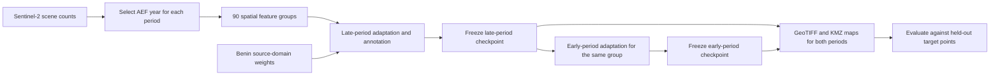

# Cahsew mapping research

This study extends national-scale mapping of smallholder cashew in Benin to 11 West African countries. The workflow produces 10 m cashew distribution maps for two periods, **2018–2019** and **2024–2025**, using annual AlphaEarth Foundations (AEF) embeddings and regional domain adaptation. The work builds on Yin et al.'s high-resolution mapping of cashew in Benin. [Benin study](https://doi.org/10.1016/j.rse.2023.113695) · [AEF data catalog](https://developers.google.com/earth-engine/datasets/catalog/GOOGLE_SATELLITE_EMBEDDING_V1_ANNUAL)

## Study workflow

1. **Select an imagery year for each tile.** For each period, count the Sentinel-2 scenes from each candidate year that intersect the tile and have less than 60% scene-level cloud cover. Use the AEF embedding from the year with more scenes. Each 10 m pixel has a 64-dimensional embedding.
2. **Group tiles by features and spatial adjacency.** Compute the mean and standard deviation of each AEF dimension within each tile. Combine feature similarity, spatial adjacency, and geographic distance in Ward hierarchical clustering. The inventory contains **676 unique tiles in 90 groups**. Group membership is shared across both periods, giving **180 group-period mapping tasks**.
3. **Adapt the Benin source model.** Initialize each late-period group from the same source-domain weights. Use labeled source imagery and unlabeled target imagery for adaptation. During training, select hard examples and produce four-class training labels from dated high-resolution imagery. Initialize the early period from the selected late-period weights for the same group. Reserve the supplementary labels for late-period training.
4. **Select, export, and evaluate.** The training agent uses recorded evidence to make tuning, stopping, and checkpoint-selection decisions. Once the checkpoint is frozen, export a four-class argmax map and a version that marks low-confidence cashew predictions as uncertain, each in GeoTIFF and KMZ formats. The target-domain reference set contains **8,313 distinct locations**, collected by grid-based stratified random sampling and supplemental searches for cashew sites.

## Documentation

- Study area, imagery selection, grouping, training, and evaluation. [Manuscript supplement](docs/manuscript-supplement.md)
- Tile-level scene counts, selected years, group membership, and supplementary figures. [Tables and figures](methods/data/README.md)
- Software environment, required inputs, commands, and outputs. [Reproduction guide](docs/reproduction.md)
- Initialization, training history, tuning, stopping, and checkpoint selection. [Training agent skill](workflow/.codex_training_current_account/skills/cashew-fada-training-expert/SKILL.md)
- Dated imagery interpretation and four-class annotation on the original AEF grid. [Annotation skill](workflow/.codex_training_current_account/skills/cashew-sample-assist/SKILL.md)

Filenames often use `2019` and `2025` as period identifiers. The tile inventory records the actual imagery year for each tile.
