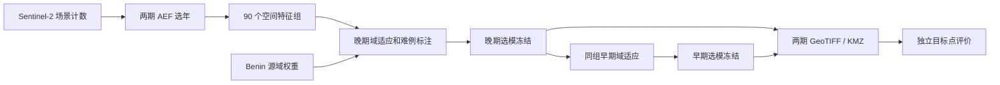

# Cahsew mapping research

本研究把 Benin 全国小农腰果制图扩展到西非 11 个国家，在 **2018–2019** 和 **2024–2025** 两期生成 10 m 腰果分布图。研究起点是 Yin 等人基于高分辨率影像绘制的 Benin 全国腰果图。西非扩展使用 AlphaEarth Foundations（AEF）年度嵌入和分区域域适应。 [Benin 研究](https://doi.org/10.1016/j.rse.2023.113695) · [AEF 数据说明](https://developers.google.com/earth-engine/datasets/catalog/GOOGLE_SATELLITE_EMBEDDING_V1_ANNUAL)

## 研究怎么做

1. **逐瓦片选年。** 在每期的两个候选年份中，统计覆盖瓦片且场景云量低于 60% 的 Sentinel-2 影像数，选择数量更多的年份，并取该年的 AEF 年度嵌入。每个 10 m 像元有 64 维嵌入。完整比较方法和年份分布见[论文补充材料](docs/manuscript-supplement.md)。
2. **按特征和空间邻接分组。** 用瓦片内 AEF 各维度的均值和标准差描述地表特征，再结合空间邻接与组内距离进行 Ward 层次分组。研究清单含 **676 个唯一瓦片、90 个分组**。同一组成员用于两期研究设计，对应 **180 个组别×时期任务**。
3. **从 Benin 源域迁移。** 晚期从统一源模型初始化，用源域监督和无标签目标影像做适应，并按训练进展挑选难例，用有日期的高分辨率影像生成四类训练标签。早期从同组晚期选定的模型权重初始化，不继承晚期标签。
4. **选模、制图和评价。** 训练 Agent 根据可追溯的训练证据决定调参、停止和选模。确认最终 checkpoint 后，输出四类 argmax 和保留低置信腰果为“不确定”的两套 GeoTIFF 与 KMZ。使用按格网分层抽样并人工补充腰果点的独立参考集进行评价，包含 **8,313 个去重地理点位**。

## 阅读入口

- [论文补充材料](docs/manuscript-supplement.md)介绍前期研究、研究区、AEF 选年、分组依据、训练和评价方法。
- [研究数据表和图的说明](methods/data/README.md)介绍瓦片年份、观测数、组别成员和汇总图。
- [复现指南](docs/reproduction.md)列出环境、输入资产、运行命令和产物位置。
- [Agent 训练 Skill](workflow/.codex_training_current_account/skills/cashew-fada-training-expert/SKILL.md)定义初始化、查询历史、调参、STOP 和 SELECT。[自动标注 Skill](workflow/.codex_training_current_account/skills/cashew-sample-assist/SKILL.md)定义有日期的影像判读与原始网格四类标签。

涉及早晚期的文件名常使用 `2019` 和 `2025`。这两个数字是**时期标识**。瓦片清单记录各地的实际影像年份。
